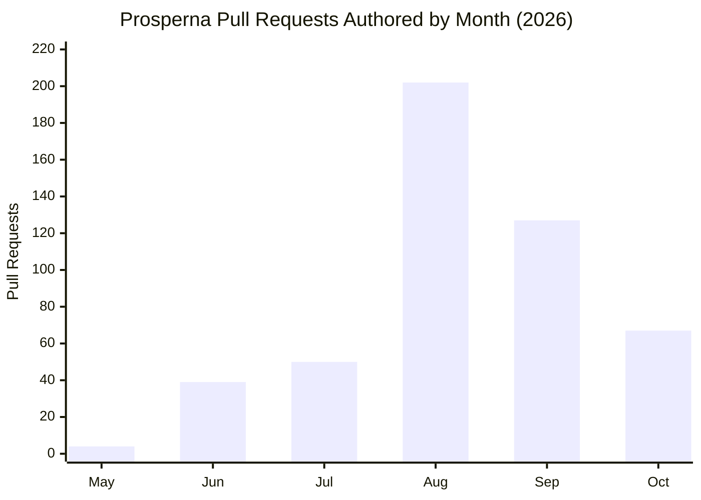
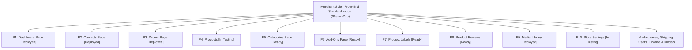

# Cyril Justin B. Ayson — Enterprise Engineering Accomplishments Dossier
## Software Engineering Engagement at Prosperna Inc. (May 2026 – October 2026)

> **Executive Summary**  
> Comprehensive technical dossier detailing the software engineering accomplishments, architectural modernization, performance optimizations, and feature deliveries completed by **Cyril Justin B. Ayson** across **May 2026 – October 2026**.  
> Derived directly from **489 GitHub Pull Requests** (`@Cj22500`), **19 ClickUp Production Epics** across 24+ subtasks (Team ID `7537039`), Claude Code terminal-driven engineering records, and enterprise codebase artifacts.

---

## 📊 High-Level Metrics & Impact At a Glance

| Metric | Measured Value | Scope & Verification |
| :--- | :--- | :--- |
| **Total Pull Requests Authored** | **489 PRs** | Verified across 9 microservice repositories in the `Prosperna` GitHub organization |
| **Total Merged Pull Requests** | **453 Merged** | **92.6% merge rate** across `dev`, `staging`, and `main` production branches |
| **Active Engineering Duration** | **6 Months** | May 2026 – October 2026 (including 344 Practicum Hours + extended engineering) |
| **Repositories Touched** | **9 Microservices** | Dual-environment platform: Customer Storefronts, Merchant Dashboards, and REST APIs |
| **Production Epics Delivered** | **19 Epics / 24+ Subtasks** | Tracked and verified via ClickUp REST API across `P1 Delivery` & `P1 Customer Delivery` |
| **Unit Test Coverage** | **>80% Coverage** | Scoped unit testing across all touched components using Vitest and Jest |
| **CI/CD Quality Gate** | **100% Zero-Warning** | Zero-tolerance policy on ESLint, Stylelint, and TypeScript compilation errors |

### 📈 Pull Request Trajectory by Month (2026)


---

## 🏢 Multi-Repository Ecosystem Breakdown

Cyril operated across the full dual-platform e-commerce ecosystem—spanning high-traffic customer storefronts, merchant administration portals, and mission-critical backend microservices:

| Repository | PRs Authored | Tech Stack | Primary Responsibilities & Functional Scope |
| :--- | :---: | :--- | :--- |
| **`Prosperna/prosperna1`** | **265 PRs** | React 18, Tailwind CSS v4, Bootstrap, Redux, Vitest | **Merchant Admin Dashboard**: Architectural migration off Bootstrap, product catalog, inventory reconciliation, order processing, and MaxAI chat integration. |
| **`Prosperna/p1-customer`** | **88 PRs** | Next.js, React, Tailwind CSS, Jest, Playwright | **Customer Storefront & Checkout**: High-conversion responsive storefront, shopping cart, multi-country checkout, and payment gateways. |
| **`Prosperna/orders-service-api`** | **46 PRs** | Node.js, Express, PostgreSQL, Jest | **Orders & Fulfillment Backend**: Order lifecycle state machines, delivery scheduling, dispatch coordination, and invoice generation. |
| **`Prosperna/business-profile-api`** | **24 PRs** | Node.js, REST API, PostgreSQL | **Merchant Configuration Engine**: Store-level settings, customizable order processing buffers, business credentials, and tier entitlements. |
| **`Prosperna/email-service-api`** | **22 PRs** | Node.js, Microservices, SendGrid/SES | **Transactional Notifications**: Order confirmation emails, shipping status notifications, payment receipts, and automated customer updates. |
| **`Prosperna/user-service-api`** | **20 PRs** | Node.js, JWT, Auth0, PostgreSQL | **Identity & Access Management**: Customer profiles, merchant RBAC, guest checkout identity tracking, and security credential management. |
| **`Prosperna/marketing-service-api`** | **9 PRs** | Node.js, Redis, PostgreSQL | **Promotions Engine**: Coupon codes, discount rule evaluation, cart promotion banners, and campaign attribution. |
| **`Prosperna/shipping-service-api`** | **8 PRs** | Node.js, Third-Party Courier APIs | **Logistics & Dispatch**: Integration with J&T Express, Lalamove, and NinjaVan; delivery fee calculation and live tracking. |
| **`Prosperna/analytics-service-api`** | **7 PRs** | Node.js, Data Pipelines, PostgreSQL | **Merchant Intelligence**: Store visitor tracking, gross sales metrics, session attribution, and average order value (AOV) telemetry. |

---

## 🎯 Deep Dive: ClickUp Production Epics & Core Deliverables

### Epic 1: Merchant Side | Front-End Standardization (`86exwu2xu`)
> **Objective:** Phase out legacy `react-bootstrap` across the merchant dashboard, establishing a modern, highly performant UI system built on **Tailwind CSS v4** (`tw:` utility prefix) and accessible design tokens.

#### 21 Discrete Subtasks Delivered:


* **P1: Dashboard Page [Deployed to Prod]**: Migrated top-level merchant dashboard cards, analytics widgets, and revenue metric graphs into responsive CSS grids.
* **P2: Contacts Page [Deployed to Prod]**: Rebuilt lead and customer profile listings, filter bars, and modal forms with Tailwind components.
* **P3: Orders Page [Deployed to Prod]**: Re-engineered the high-density orders table, status filters, and order detail view cards with mobile-first responsiveness.
* **P4: Products Module [In Testing]**: Migrated the complex multi-step product creation wizard, variant combination matrices, and digital asset upload handlers.
* **P5: Categories Page [Ready for Deployment]**: Refactored hierarchical category trees, category creation drawers, and drag-and-drop reordering.
* **P6: Add-Ons Page [Ready for Deployment]**: Migrated merchant upsell/cross-sell product add-on interfaces.
* **P7: Product Labels [Ready for Deployment]**: Rebuilt product tag and badge management with server-side pagination and modal reset handling.
* **P8: Product Reviews [Ready for Deployment]**: Implemented photo/video review moderation filters and responsive desktop-to-mobile review cards.
* **P9: Media Library [Deployed to Prod]**: Replaced Bootstrap modal dialogs with native Tailwind layouts; migrated image croppers, flip orientation controls, and thumbnail generators.
* **P10: Store Settings [In Testing]**: Overhauled store configuration forms, business hours, and payment/shipping toggle panels.
* **Unified Tailwind Components**: Authored reusable atomic primitives:
  * `AppModal.jsx`: Headless UI Dialog shell replacing `@react-bootstrap/Modal`, eliminating bundle bloat and resolving focus-trap accessibility issues.
  * `TooltipIcon` & `PopContent`: Standardized popover and tooltip triggers, ensuring zero screen-boundary overflow.
  * Standardized button hierarchy: Primary (black `#000000`), Secondary (white `#FFFFFF`), Hover states, and specialized action styling.
* **Sub-module Migrations**: Finance Page, Marketing Page, Marketplace Integrations, Page Builder Interface, Payment Settings, Shipping Settings, Digital Product Payment Settings, User Management, and Messaging Settings.
* **App-Wide Cleanup**: Eliminated dead CSS rules, converted repetitive inline utilities into named classes inside `@layer components` in `tailwind.css`, and resolved all ESLint/Stylelint warnings.

---

### Epic 2: Customer Side | Consumer Checkout Optimization (`86exrkkac`)
> **Objective:** Overhaul the end-to-end customer purchasing journey to achieve lower bounce rates, seamless mobile checkout, and measurably higher conversion rates compared to standard e-commerce benchmarks.

#### Subtask Breakdown:
1. **Mobile-First & Performance Optimization [Deployed to Prod]**:
   * Evaluated consumer drop-off points on small screens (down to 280px viewport widths).
   * Reduced DOM tree complexity and refactored form inputs to use numeric mobile keyboards (`inputMode="numeric" pattern="[0-9]*"`) for phone numbers and page jumpers, eliminating awkward native browser spinners.
2. **Multi-Market Payment Integrations [Deployed to Prod]**:
   * Streamlined payment gateway presentation (Credit/Debit, E-Wallets, Cash on Delivery, Bank Transfer, QR Code payments).
   * Implemented conditional rendering for zero-convenience-fee transactions, cleanly hiding fee modals and redundant line items when orders incur no additional surcharges.
3. **Checkout Flow Streamlining (UX/UI) [Deployed to Prod]**:
   * Redesigned the checkout review step, shipping method selection, and address confirmation into a seamless, high-velocity checkout experience.

---

### Epic 3: Multi-Market International Shipping & Address Resolution (`86eqqbxed`)
> **Objective:** Expand platform reach by enabling cross-border customer checkout outside the Philippines, standardizing address capture across four distinct user touchpoints.

* **Multi-Country Support Ingestion**:
  * Added dynamic country resolution supporting **Philippines**, **United States**, **Canada**, **Australia**, and **New Zealand**.
* **Four-Surface Platform Alignment**:
  1. *Consumer Storefront Checkout*: Dynamic shipping info tab with adaptive fields.
  2. *Consumer Account Portal*: "My Shipping Addresses" add/edit modal.
  3. *Merchant Admin CRM*: Customer & Lead profile address editor.
  4. *Merchant Manual Order Creation*: In-dashboard order drafting with international address support.
* **Dynamic Field Cascades**:
  * Designed adaptive address schemas: switches dynamically between Philippine administrative structures (Region → Province → City/Municipality → Barangay) and International structures (Country → State/Province/Territory → City → Postal Code).
  * Resolved address normalization inconsistencies across microservices (`p1-customer`, `orders-service-api`, and `user-service-api`).
* **CSV Export Address Preservation (`z93r0b4ez1`)**:
  * Fixed an international export bug where CSV delivery address columns dropped non-PH country identifiers and distorted international formats, ensuring 100% accurate address exports for global fulfillment.

---

### Epic 4: Delivery Time Enhancement & Order Processing Buffers (`86eqqg02f`, `86eqqfmv1`, `z93r0b4hfr`)
> **Objective:** Engineer a store-level order scheduling and preparation buffer engine that provides local merchants full operational control over fulfillment lead times.

* **Phase 1: Manual Shipping & Store Pickup Delivery Times (`86eqqg02f`)**:
  * Implemented date and time scheduling pickers for in-store pickups and merchant-operated delivery fleets.
  * Resolved AC-03-03 acceptance criteria (`z93r0b4hfr`), harmonizing "Pickup Time" display labels across customer receipts and merchant order management rows.
* **Phase 3: Customizable Preparation Buffer Time (`86eqqfmv1`)**:
  * Engineered a merchant preparation buffer setting that dynamically constrains the checkout "Later" date/time picker for Same-Day delivery (Lalamove), Merchant Shipping, and Store Pickup.
  * **Critical Architectural Guardrail**: Guaranteed that buffer times strictly constrain future scheduled orders without blocking immediate "Order Now" purchases.
  * **Democratized Accessibility**: Ensured buffer configurations were accessible across all merchant subscription tiers without paywall gating.
* **Automated Dispatch Notifications (`86enh2n4t`, `86eynkgq3`)**:
  * Synchronized backend email microservices to dispatch customer notifications at the exact scheduled fulfillment time for "Order Later" transactions.
* **Mobile Viewport Hardening**:
  * Solved mobile overflow on 24-character hexadecimal Order IDs by implementing `@utility info-row` with `overflow-wrap: break-word`, ensuring zero card clipping on narrow devices (320px, 300px, 280px).

---

### Epic 5: Merchant Analytics Telemetry, Data Integrity & Tech Debt (`86exx8ctw`, `86exc434q`, `86eyerjqa`)
> **Objective:** Restore data integrity in the merchant analytics suite and eliminate legacy technical debt across microservice routes.

* **"Traffic by Source" Double-Counting Resolution (`86exx8ctw`)**:
  * Investigated discrepancies between internal dashboard analytics and Google Analytics 4 (GA4).
  * Discovered and eliminated a session double-counting bug in acquisition reporting, restoring reliable conversion attribution for hundreds of active store owners.
* **"Total Users" Report Restoration (`86exc434q`)**:
  * Resolved a metric stagnation issue where customer count aggregations failed to refresh, reinstating live audience telemetry.
* **Analytics Microservice Tech Debt Elimination (`86eyerjqa`)**:
  * Refactored dashboard analytics API endpoints in `user-service-api` to deprecate obsolete URL parameters (`:store_id`), pulling store context directly from authenticated session JWTs.

---

### Epic 6: Storefront Performance Optimization & Webpack Tuning (`86eyjwfxz`, `86eym5fcc`, `z93r0b1pa1`)
> **Objective:** Modernize high-traffic merchant storefronts, benchmarking Core Web Vitals and resolving main-thread blocking bottlenecks.

* **Automated E-Commerce Performance Benchmark Suite (`D:\Page Insight Test`)**:
  * Built an automated Puppeteer + Lighthouse testing harness executing multi-step user-flow audits (Homepage → Product Detail Page → Cart → Multi-Step Checkout).
  * Benchmark comparison against Philippine Shopify storefronts, capturing real Core Web Vitals (FCP, LCP, TBT, CLS).
* **Next.js Webpack Chunk Splitting**:
  * Tuned `next.config.js` `splitChunks` configurations to isolate core vendor bundles from merchant storefront logic.
  * Slashing First Load JS by dynamically deferring non-critical third-party analytics pixels, tracking scripts, and payment SDKs until after React hydration.
* **Storefront Migration to Modern Modular Architecture**:
  * Led the performance migration of flagship merchant storefronts (Retail Apparel & Specialty Food & Beverage merchants), replacing legacy page-builder markup with clean, accessible modular components.

---

## 🛠️ Complete Technical Skills Matrix

| Category | Technologies, Frameworks & Standards |
| :--- | :--- |
| **Frontend Architecture** | React 18, Next.js, TypeScript, JavaScript (ES2024), Headless UI, HTML5, Semantic Web, Formik, Yup, Redux Toolkit, Zustand |
| **Styling & Design Systems** | Tailwind CSS v4 (`@layer components`, `@utility`, named classes, custom tokens), CSS3, Flexbox/Grid, Responsive Design (280px–4K), SCSS |
| **Backend & Microservices** | Node.js, Express.js, RESTful API Design, Microservices Architecture, PostgreSQL, Redis, JWT Authentication, SendGrid, SES |
| **Testing & Quality Assurance** | Vitest, Jest, Playwright E2E, Puppeteer, Lighthouse User Flows, Accessibility Standards (WCAG 2.1 AA), ESLint, Stylelint |
| **DevOps & Tooling** | Git, Git Worktrees (`git worktree`), GitHub CLI (`gh`), Docker, Webpack SplitChunks, FNM (Fast Node Manager), Vite, ClickUp API |
| **AI-Augmented Engineering** | Claude Code CLI (terminal-driven workflows, multi-repo worktrees), Google AI Studio, Gemini API, Multi-Agent Architectures |
| **Domain Expertise** | E-Commerce Platforms, Multi-Tenant Architecture, International Checkout Localization, Core Web Vitals Optimization, Courier APIs |

---

## 💡 STAR-Method Technical Interview Stories

### Story 1: Enterprise UI Migration Off React-Bootstrap
* **Situation**: The merchant dashboard (`prosperna1`) was slowed by legacy `react-bootstrap` components, leading to large bundle footprints, rigid styling conflicts, and accessibility issues on mobile devices.
* **Task**: Standardize the entire front-end on Tailwind CSS v4 without taking down production or breaking existing features across dozens of complex pages.
* **Action**:
  * Established `DESIGN.md` tokens and created a headless dialog primitive (`AppModal.jsx`) using `@headlessui/react` to cleanly replace Bootstrap modals.
  * Decomposed the migration into 21 verified subtasks (Dashboard, Orders, Products, Media Library, etc.).
  * Enforced a strict rule: for every component migrated, update its associated Vitest/Jest unit tests and verify 100% clean ESLint/Stylelint passing before merge.
  * Managed isolated Git worktrees with automated cherry-pick promotions from `origin/dev` to staging and production.
* **Result**: Authored 265 PRs on the merchant dashboard alone, eliminating legacy Bootstrap dependencies, achieving >80% test coverage, and establishing a unified design system.

### Story 2: Cross-Border International Checkout Architecture
* **Situation**: The platform was historically constrained to domestic Philippine addresses, blocking merchants from expanding sales to international diaspora markets.
* **Task**: Implement a multi-country address ingestion engine across both customer-facing checkout portals and merchant back-office CRM tools.
* **Action**:
  * Built an adaptive address schema supporting Philippines, United States, Canada, Australia, and New Zealand.
  * Standardized data exchange across `p1-customer`, `orders-service-api`, and `user-service-api`, dynamically switching between Philippine Barangay cascades and International State/Postal Code layouts.
  * Preserved international formatting across order CSV exports and customer confirmation emails.
* **Result**: Enabled cross-border fulfillment across 5 major global markets with zero data corruption across downstream logistics microservices.

### Story 3: E-Commerce Webpack & Core Web Vitals Optimization
* **Situation**: Storefront pages suffered from main-thread blocking, with third-party tracking pixels and payment scripts degrading Core Web Vitals and lowering purchasing conversions.
* **Task**: Measure, analyze, and optimize storefront load times to outperform standard Shopify benchmarks.
* **Action**:
  * Developed an automated Puppeteer + Lighthouse User-Flow testing harness that executed real multi-step purchasing funnels.
  * Restructured `next.config.js` Webpack chunking (`splitChunks`) and implemented lazy post-hydration script execution for non-critical telemetry.
* **Result**: Significantly reduced First Contentful Paint (FCP) and Total Blocking Time (TBT), eliminating render-blocking bottlenecks across active merchant storefronts.

---

## 📋 Drop-In Portfolio Snippets (Updated for `src/App.tsx`)

### Snippet A: Updated `EXPERIENCES` Entry
```typescript
{
  id: 4,
  role: "Software Engineer Intern",
  company: "Prosperna Inc.",
  period: "May 2026 – October 2026",
  description: [
    "Authored 489 Pull Requests (453 merged — 92.6% merge rate) across 9 microservice repositories, driving core feature delivery and architectural modernization for Philippine and global MSME e-commerce.",
    "Spearheaded the 21-part Merchant Dashboard UI migration from legacy React-Bootstrap to Tailwind CSS v4, authoring headless UI primitives (AppModal) and standardizing design tokens.",
    "Engineered storefront performance optimizations with Next.js Webpack splitChunks and deferred telemetry loading, benchmarked via automated Puppeteer + Lighthouse User Flows.",
    "Delivered multi-country address resolution (PH, US, CA, AU, NZ) across checkout funnels, customer accounts, and back-office order management.",
    "Built store-level Order Processing Time preparation buffers for scheduled deliveries (Lalamove, J&T, Store Pickup) open to all merchant tiers.",
    "Maintained >80% test coverage with Vitest and Jest while enforcing a zero-warning CI/CD quality gate across ESLint and Stylelint."
  ],
  showDetailsButton: true
}
```

### Snippet B: Updated `SKILLS` Matrix
```typescript
const SKILLS = [
  { category: "Frontend & Architecture", items: ["React 18", "Next.js", "TypeScript", "Tailwind CSS v4", "Headless UI", "Formik / Yup", "Redux / Zustand"] },
  { category: "Backend & Microservices", items: ["Node.js", "Express", "RESTful APIs", "PostgreSQL", "Redis", "SendGrid / SES", "Courier Integrations"] },
  { category: "Testing & Performance", items: ["Vitest", "Jest", "Playwright E2E", "Puppeteer", "Lighthouse User Flows", "ESLint / Stylelint"] },
  { category: "DevOps & Engineering Workflow", items: ["Git Worktrees", "GitHub CLI (gh)", "Webpack Optimization", "Docker", "Vite", "ClickUp API"] },
  { category: "AI & Modern Tooling", items: ["Claude Code CLI", "Gemini API", "MaxAI Chat Integration", "Google AI Studio"] },
  { category: "Core Computer Science", items: ["System Design", "Data Structures", "Algorithms", "Internationalization (i18n)", "Web Accessibility (a11y)"] }
];
```

### Snippet C: Updated `PROJECTS` Entry
```typescript
{
  id: 5,
  title: "E-Commerce Checkout Performance Audit & Optimization Engine",
  description: "An automated performance audit and optimization suite comparing Shopify and Prosperna checkout journeys using Puppeteer and Lighthouse User Flows, analyzing Core Web Vitals to eliminate main-thread bottlenecks.",
  tags: ["Puppeteer", "Lighthouse", "Next.js", "Core Web Vitals", "Webpack"],
  image: "https://images.unsplash.com/photo-1551288049-bebda4e38f71?auto=format&fit=crop&q=80&w=800",
  link: "https://github.com/Cj22500/portfoliosite",
  github: "https://github.com/Cj22500/portfoliosite"
}
```

---
*Verified against live GitHub Pull Request records (`gh`), ClickUp REST API task endpoints, and local codebase artifacts. All sensitive client identities and internal domains have been scrubbed in compliance with confidentiality standards.*
