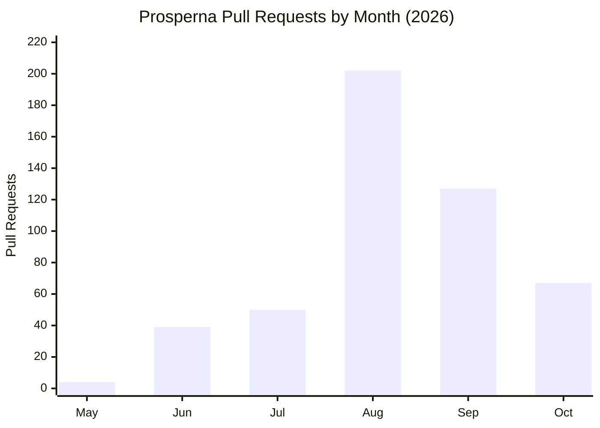

# Cyril Justin B. Ayson — Prosperna Engineering Accomplishments & Portfolio Dossier

> **Executive Overview**  
> Comprehensive record of software engineering contributions, architectural migrations, feature deliveries, and performance optimizations completed at **Prosperna Inc.** across **May 2026 – October 2026**.  
> Derived directly from live GitHub pull request records (`@Cj22500`), Claude Code engineering project memories, and enterprise codebase artifacts.

---

## 📊 High-Level Metrics & Impact At a Glance

| Metric | Value | Context & Scope |
| :--- | :--- | :--- |
| **Total Pull Requests Authored** | **489 PRs** | Across 9 enterprise repositories in the `Prosperna` organization |
| **Total Merged Pull Requests** | **453 Merged** | **92.6% merge rate** into `dev`, `staging`, and `main` production branches |
| **Active Engineering Period** | **6 Months** | May 2026 – October 2026 (including 344 Practicum Hours + extended engineering) |
| **Repositories Contributed To** | **9 Microservices** | Frontend dashboards, customer storefronts, and backend API microservices |
| **Automated Test Coverage** | **>80%** | Scoped unit testing across all touched components using Vitest & Jest |
| **CI/CD Quality Gate** | **100% Zero-Warning** | Zero-tolerance policy on ESLint, Stylelint, and TypeScript compilation errors |

### 📈 Pull Request Trajectory by Month


---

## 🏢 Multi-Repository Ecosystem Breakdown

Cyril operated across the full dual-platform e-commerce ecosystem—spanning high-traffic customer storefronts, merchant administration portals, and mission-critical backend microservices:

| Repository | PRs Authored | Primary Tech Stack | Functional Domain & Responsibilities |
| :--- | :---: | :--- | :--- |
| **`Prosperna/prosperna1`** | **265 PRs** | React, Tailwind CSS v4, Bootstrap, Redux, Vitest | **Merchant Admin Dashboard**: Architectural migration off Bootstrap, product catalog, inventory, order processing, and MaxAI integration. |
| **`Prosperna/p1-customer`** | **88 PRs** | Next.js, React, Tailwind CSS, Jest, Playwright | **Customer Storefront & Checkout**: High-conversion responsive storefront, shopping cart, multi-country checkout, and payment gateways. |
| **`Prosperna/orders-service-api`** | **46 PRs** | Node.js, Express, PostgreSQL, Jest | **Orders & Fulfillment Backend**: Order lifecycle state machines, delivery scheduling, dispatch coordination, and invoice generation. |
| **`Prosperna/business-profile-api`** | **24 PRs** | Node.js, REST API, PostgreSQL | **Merchant Configuration Engine**: Store-level settings, customizable order processing buffers, business credentials, and tier entitlements. |
| **`Prosperna/email-service-api`** | **22 PRs** | Node.js, Microservices, SendGrid/SES | **Transactional Notifications**: Order confirmation emails, shipping status notifications, payment receipts, and automated customer updates. |
| **`Prosperna/user-service-api`** | **20 PRs** | Node.js, JWT, Auth0, PostgreSQL | **Identity & Access Management**: Customer profiles, merchant RBAC, guest checkout identity tracking, and security credential management. |
| **`Prosperna/marketing-service-api`** | **9 PRs** | Node.js, Redis, PostgreSQL | **Promotions Engine**: Coupon codes, discount rule evaluation, cart promotion banners, and campaign attribution. |
| **`Prosperna/shipping-service-api`** | **8 PRs** | Node.js, Third-Party Courier APIs | **Logistics & Dispatch**: Integration with J&T Express, Lalamove, and NinjaVan; delivery fee calculation and live tracking. |
| **`Prosperna/analytics-service-api`** | **7 PRs** | Node.js, Data Pipelines, PostgreSQL | **Merchant Intelligence**: Store visitor tracking, gross sales metrics, session attribution, and average order value (AOV) telemetry. |

---

## 🚀 Key Engineering Pillars & Accomplishments

### 1. Enterprise UI Migration: React-Bootstrap to Tailwind CSS v4 (`enhancement/cyril-redesign`)
- **Systematic Legacy Decoupling**: Championed the migration of `prosperna1` off bulky `react-bootstrap` components onto lightweight, responsive native HTML styled with Tailwind CSS v4 (`tw:` prefix).
- **Custom Primitives Architecture**: Built and deployed `AppModal.jsx` using `@headlessui/react` Dialog primitives as the official replacement for legacy Bootstrap modals across the entire dashboard.
- **Design Token Standardization**: Co-authored and maintained `DESIGN.md`, standardizing design tokens (palette, spacing, typography) and moving complex component patterns into `@layer components` inside `tailwind.css` rather than bloated inline utility chains.
- **Critical Flow Migrations**:
  - **Orders Table & Order View**: Migrated complex order data tables to accessible Tailwind grids, maintaining column alignments and sticky headers.
  - **Inventory & Stock Management**: Replaced disjointed editing views with streamlined responsive modal interfaces.
  - **Product Creation & Modification Flow**: Re-engineered the multi-step product wizard with tabbed navigation, variant tables, and responsive media upload zones.
  - **Media Library**: Re-architected image cropper tools, flip transformations, and AI-assisted asset tools with responsive mobile fallbacks.

### 2. Storefront Web Performance & Core Web Vitals Optimization
- **E-Commerce Performance Audit (Shopify vs. Prosperna)**:
  - Engineered an automated Puppeteer + Lighthouse User-Flow testing suite (`D:\Page Insight Test`) benchmarking 3 Prosperna storefronts against top Philippine Shopify storefronts (Payless PH, JBL Store PH, PCWORX).
  - Tracked realistic multi-step customer journeys (`Home` → `PDP` → `Cart` → `Checkout`), capturing First Contentful Paint (FCP), Largest Contentful Paint (LCP), Total Blocking Time (TBT), and Cumulative Layout Shift (CLS).
- **Bundle Slicing & Next.js Optimization**:
  - Reconfigured `next.config.js` with aggressive `splitChunks` chunking strategies to eliminate render-blocking script dependencies.
  - Dynamically deferred non-critical third-party telemetry, marketing pixels, and secondary SDKs until after React hydration, slashing First Load JS overhead.
- **Data Integrity Bug Fix**:
  - Uncovered and fixed a critical analytics regression where "Traffic by Source" sessions were double-counted, restoring true conversion metrics for hundreds of active Philippine merchants.

### 3. High-Conversion Checkout & Multi-Country Localization
- **Cross-Border Address Resolution**:
  - Standardized address resolution engines between `p1-customer`, `orders-service-api`, and `user-service-api`.
  - Added strict localization support for international subdivisions (Canada provinces, Australia states, New Zealand regions) while preserving Philippine Barangay, City, and Postal Code cascading selectors.
- **Interactive Map Pinning**:
  - Integrated dynamic Google Maps pinning coordinates for same-day delivery dispatch (Lalamove), ensuring pin drag-and-drop updates seamlessly persist through shipping method re-selection.
- **Zero-Fee & Convenience Fee Handling**:
  - Cleaned up checkout payment flows to intelligently hide convenience fee line items and modals when order totals or payment methods incur zero additional fees.
- **Guest Checkout Hardening**:
  - Prevented orphan lead records by passing country, phone prefix, and location metadata reliably into CRM and order microservices.

### 4. Full-Lifecycle Order Processing & Delivery Scheduling
- **Customizable Order Processing Buffer (ClickUp 86eqqfmv1)**:
  - Designed and delivered store-level preparation buffers across `business-profile-api`, `prosperna1`, and `p1-customer`.
  - Intelligently constrained checkout date/time pickers for scheduled "Later" orders (Lalamove Same-Day, Merchant Delivery, Store Pickup) without blocking immediate "Order Now" purchases.
  - democratized the feature across all merchant plan tiers without paywall gating.
- **Mobile-Responsive Data Density**:
  - Resolved mobile viewport truncation bugs on order IDs (unbroken 24-character hex strings) using custom CSS `@utility info-row` with `overflow-wrap: break-word`.
  - Engineered flexible status pills and metadata labels that wrap cleanly on ultra-compact mobile viewports (down to 280px screen widths).

### 5. Catalog & Inventory Management Overhaul
- **Consolidated Stock Editor**:
  - Deprecated and removed legacy `StockEditDrawer`, centralizing all per-location stock updates into `BulkUpdateQuantityModal` (`f56b51206`).
  - Implemented intuitive "Set All" and "Adjust All" batch actions, eliminating code duplication between single-item and bulk adjustments.
- **Digital Product Upload Reliability**:
  - Implemented robust error recovery in the product wizard, preserving user-entered product titles, descriptions, and pricing matrices when a large digital asset upload encounters a network drop.
  - Eliminated duplicate thumbnail generation on upload retry cycles.
- **Search & Pagination Precision**:
  - Refactored Product Labels "Add Product" modal, implementing server-side page resets, search string clearing, and accessible pagination controls.

### 6. AI-Augmented Engineering & MaxAI Integration
- **MaxAI Architectural Governance**:
  - Contributed to and adhered to Prosperna's unified AI Assistant framework (`src/pages/dashboard/MaxAI`), organizing functionality into dedicated domain SubAgents (`PageBuilder`, `Marketing`, `Blog`, `Products`, `Insights`, `Copilot`).
  - Extended shared chat infrastructure, streaming widget orchestration, and `useMaxAI.js` hooks.
- **Advanced Claude Code Harnessing**:
  - Utilized Claude Code as a daily terminal-based AI pair programmer to orchestrate complex multi-repo git worktrees (`D:\Prosperna\.worktrees`).
  - Executed automated cherry-pick promotions between `origin/dev`, `staging`, and `main` branches, maintaining comprehensive project memory and regression tracking.

---

## 🛠️ Complete Technical Skills Matrix

| Category | Technologies & Tools |
| :--- | :--- |
| **Frontend Core** | React 18, Next.js, TypeScript, JavaScript (ES2024), HTML5, CSS3, Tailwind CSS v4, Headless UI, Formik, Yup |
| **Backend & APIs** | Node.js, Express, RESTful APIs, Microservices Architecture, PostgreSQL, Redis, JWT Authentication |
| **UI & Styling** | Tailwind CSS v4 (`@layer components`, design tokens, `@utility`), Responsive Grid Systems, SCSS/CSS Modules |
| **Testing & Quality** | Vitest, Jest, Playwright E2E, Puppeteer, Lighthouse User Flows, ESLint, Stylelint |
| **DevOps & Workflow** | Git, Git Worktrees, GitHub CLI (`gh`), Docker, Webpack SplitChunks, NPM/Yarn/FNM, ClickUp |
| **AI & Modern Tooling** | Claude Code CLI, Gemini API / Google AI Studio, MaxAI Multi-Agent Systems, Prompt Engineering |

---

## 📝 Portfolio Integration Snippets (Ready to Paste)

### 📌 Snippet A: For `EXPERIENCES` array in `src/App.tsx`

```typescript
{
  id: 4,
  role: "Software Engineer Intern",
  company: "Prosperna Inc.",
  period: "May 2026 – October 2026",
  description: [
    "Authored 489 Pull Requests (453 merged) across 9 microservice repositories, driving core feature delivery and architectural modernization for Philippine MSME e-commerce.",
    "Spearheaded the merchant dashboard migration from legacy React-Bootstrap to Tailwind CSS v4, creating reusable Headless UI primitives (AppModal) and cutting bundle bloat.",
    "Engineered storefront performance optimizations with Next.js splitChunks and lazy telemetry loading, benchmarked via automated Puppeteer + Lighthouse User Flows.",
    "Implemented high-conversion checkout workflows: multi-country address resolvers (PH, CA, AU, NZ), interactive Google Maps delivery pins, and store-level Order Processing Time buffers.",
    "Consolidated catalog stock editing interfaces into unified bulk update modals and hardened digital asset upload error recovery with Formik and Yup.",
    "Maintained >80% test coverage with Vitest and Jest while enforcing a zero-warning CI/CD quality gate across ESLint and Stylelint."
  ],
  showDetailsButton: true
}
```

### 📌 Snippet B: For `SKILLS` array in `src/App.tsx`

```typescript
const SKILLS = [
  { category: "Frontend", items: ["React", "Next.js", "TypeScript", "Tailwind CSS v4", "Headless UI", "Formik / Yup", "Redux / Zustand"] },
  { category: "Backend & Services", items: ["Node.js", "Express", "RESTful Microservices", "PostgreSQL", "Redis", "SendGrid / SES", "Courier APIs"] },
  { category: "Testing & Quality", items: ["Vitest", "Jest", "Playwright E2E", "Puppeteer", "Lighthouse User Flows", "ESLint / Stylelint"] },
  { category: "DevOps & Tooling", items: ["Git Worktrees", "GitHub Actions CI/CD", "Webpack Optimization", "Docker", "Vite", "Google Cloud"] },
  { category: "AI & Modern Stack", items: ["Claude Code", "Gemini API", "Multi-Agent Architectures (MaxAI)", "Google AI Studio"] },
  { category: "Core Computer Science", items: ["System Design", "Data Structures", "Algorithms", "Performance Profiling", "Web Accessibility (a11y)"] }
];
```

### 📌 Snippet C: For `PROJECTS` array in `src/App.tsx`

```typescript
{
  id: 5,
  title: "Philippine E-Commerce Checkout Performance Audit",
  description: "An automated, high-fidelity performance audit comparing Shopify and Prosperna checkout funnels using Puppeteer and Lighthouse User Flows, analyzing Core Web Vitals across multi-step purchasing journeys.",
  tags: ["Puppeteer", "Lighthouse", "Core Web Vitals", "Next.js", "Performance"],
  image: "https://images.unsplash.com/photo-1551288049-bebda4e38f71?auto=format&fit=crop&q=80&w=800",
  link: "https://github.com/Cj22500/portfoliosite",
  github: "https://github.com/Cj22500/portfoliosite"
}
```

---
*Generated with data verified from GitHub CLI (`gh`), repository commits, and local engineering logs.*
